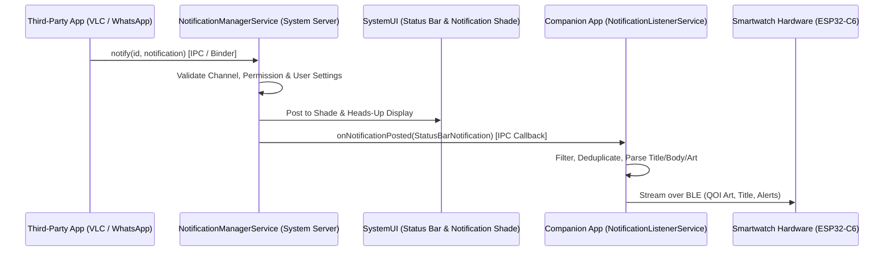
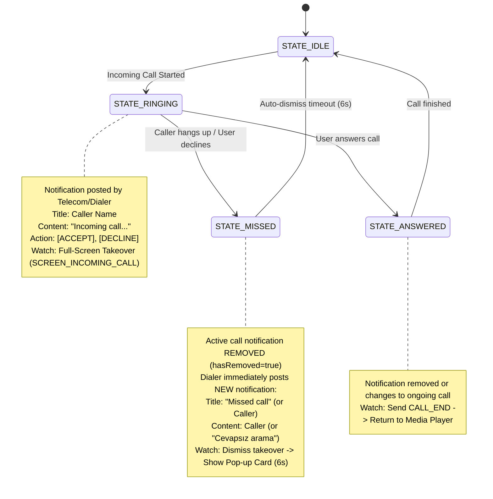

# Comprehensive Study Guide: Android Notification Architecture & Interception

**Target Audience:** Embedded & Mobile Systems Engineers (Smartwatch Companion Apps)  
**Date:** October 2026  
**Scope:** Android 5.0 through Android 14+ (HyperOS, OneUI, Pixel AOSP)

---

## Table of Contents
1. [Core Architectural Overview](#1-core-architectural-overview)
2. [Notification Types, Styles, and Visual Classes (Comprehensive)](#2-notification-types-styles-and-visual-classes-comprehensive)
3. [Notification Channels, Importance, and Categories](#3-notification-channels-importance-and-categories)
4. [How Apps Catch Notifications (`NotificationListenerService`)](#4-how-apps-catch-notifications-notificationlistenerservice)
5. [Anatomy of `StatusBarNotification` (SBN) and `extras`](#5-anatomy-of-statusbarnotification-sbn-and-extras)
6. [Interactive Actions & Direct Reply (`RemoteInput`)](#6-interactive-actions--direct-reply-remoteinput)
7. [Notification Bundling & Group Summaries (The WhatsApp Phenomenon)](#7-notification-bundling--group-summaries-the-whatsapp-phenomenon)
8. [Incoming Calls vs. Missed Calls (Telecom Lifecycle)](#8-incoming-calls-vs-missed-calls-telecom-lifecycle)
9. [OEM Quirks & Aggressive Background Restrictions (Xiaomi/HyperOS, Samsung)](#9-oem-quirks--aggressive-background-restrictions-xiaomihyperos-samsung)
10. [Engineering Blueprint for Smartwatch Companion Apps](#10-engineering-blueprint-for-smartwatch-companion-apps)
11. [How to Discover & Inspect Notifications from Any App](#11-how-to-discover--inspect-notifications-from-any-app)

---

## 1. Core Architectural Overview

In Android, notifications are **not** sent directly from App A to App B. Instead, the Android OS utilizes a centralized system daemon known as the **`NotificationManagerService` (NMS)** running inside the `system_server` process.

### The Lifecycle Flow



1. **Originating App**: Calls `NotificationManager.notify(int id, Notification notification)`.
2. **Binder IPC**: The notification data is serialized across process boundaries to `system_server`.
3. **NMS Enforcement**:
   - Checks if the app has `android.permission.POST_NOTIFICATIONS` (Android 13+).
   - Verifies the assigned **NotificationChannel** is not blocked or muted by the user.
   - Calculates visual priority (Heads-up banner vs. silent tray placement).
4. **Broadcast to SystemUI**: NMS instructs the Android `SystemUI` process to draw the notification into the status bar, lock screen, and drop-down shade.
5. **Broadcast to Listeners**: NMS dispatches the `StatusBarNotification` wrapper to all approved `NotificationListenerService` implementations (such as our companion app).

---

## 2. Notification Types, Styles, and Visual Classes

Android provides several distinct visual and semantic notification templates using the `NotificationCompat.Style` hierarchy:

### A. Basic Standard Notification
- **Structure**: Small App Icon, App Name, Title, Short Text snippet, Timestamp.
- **Use Case**: Simple alerts, downloads completed, file transfers.
- **Length**: Usually truncated to a single line in the status tray.

### B. `BigTextStyle`
- **Structure**: Expands when pulled down to reveal a large multi-line text block (`bigText`).
- **Use Case**: Long emails, text messages, notes.

### C. `BigPictureStyle`
- **Structure**: Contains a high-resolution preview image (`bigPicture`) displayed below the title.
- **Use Case**: Screenshot captures, Instagram photo previews, camera security alerts.

### D. `MessagingStyle`
- **Structure**: Introduced in Android 7.0 and refined in Android 9/10. Designed specifically for instant messaging apps (WhatsApp, Telegram, Signal).
- **Key Characteristics**:
  - Treats contacts as distinct `Person` objects (with names, contact URIs, and avatars).
  - Maintains conversation history within a single notification thread.
  - Distinct sender names for group chats vs. 1-on-1 chats.
  - Dedicated "Conversations" section at the very top of the Android shade.

### E. `MediaStyle`
- **Structure**: Designed specifically for audio and video media playback (VLC, Spotify, YouTube Music).
- **Key Characteristics**:
  - Associated with an active `MediaSession.Token`.
  - Exposes up to 3–5 compact action buttons (Previous, Play/Pause, Next) directly in the collapsed header.
  - Displays high-resolution Album Cover Art via `Notification.EXTRA_LARGE_ICON`.
  - In Android 11+, moves completely out of the notification shade into the persistent Quick Settings media carousel.

### F. `CallStyle`
- **Structure**: Introduced in Android 12 for phone and VoIP calling apps.
- **Key Characteristics**:
  - Explicit states: Incoming Call, Active Ongoing Call, Screened Call.
  - Prominent Accept and Decline action buttons.
  - High system priority that triggers a Heads-Up Display (HUD) overlay banner.

### G. `InboxStyle`
- **Structure**: Displays a list of up to 5–7 separate lines of text (digest style).
- **Use Case**: Email clients (Gmail, Outlook) summarizing multiple unread email senders/subjects, news feeds.
- **Payload**: Stored in `Notification.EXTRA_TEXT_LINES` as a `CharSequence[]`.

### H. `DecoratedCustomViewStyle` & Custom `RemoteViews`
- **Structure**: Allows apps to inflate custom Android XML layouts directly into the notification shade.
- **Use Case**: Food delivery live tracking (Uber Eats, Getir, Yemeksepeti), ride-sharing progress, specialized audio recorders.
- **Key Characteristics**: Does not use standard `title`/`text` views. Companion apps inspect raw `RemoteViews` or read `extras.getCharSequence("android.title")` if provided as fallback.

### I. Progress Bar Notifications (`setProgress`)
- **Structure**: Features a horizontal determinate bar (0% to 100%) or an animated indeterminate continuous bar.
- **Use Case**: File downloads, OS updates, cloud backup synchronization, file uploads.
- **Key Characteristics**: Sets `Notification.EXTRA_PROGRESS`, `Notification.EXTRA_PROGRESS_MAX`, and `Notification.EXTRA_PROGRESS_INDETERMINATE`.

### J. Ongoing & Foreground Service Notifications
- **Structure**: Non-dismissible notifications tied to a running Android `ForegroundService`.
- **Key Flags**:
  - `Notification.FLAG_ONGOING_EVENT` (1): The user cannot swipe it away.
  - `Notification.FLAG_NO_CLEAR` (32): Not dismissed by "Clear all".
  - `Notification.FLAG_FOREGROUND_SERVICE` (64): Bound directly to an active background service.
- **Use Case**: Persistent step counters, active GPS/fitness tracking, VPN tunnel status, active music players.

### K. Bubble Notifications (`Notification.BubbleMetadata`)
- **Structure**: Introduced in Android 10/11. Spawns a floating circular head on the screen edge that opens an overlay Activity window.
- **Use Case**: Chat apps (Messenger, Telegram, WhatsApp conversations).

### L. Full-Screen Intent Notifications (`setFullScreenIntent`)
- **Structure**: Fires an immediate, full-screen Activity taking over the display if the device is locked (display turned off or lock screen active).
- **Use Case**: Ringing incoming telephone calls, alarm clock triggers.

### M. Lockscreen Visibility States
Android allows apps to redact sensitive notification content when the device is locked:
- **`VISIBILITY_PUBLIC` (1)**: Full content shown on the lock screen.
- **`VISIBILITY_PRIVATE` (0)**: Shows icon and app name, but redacts message body (e.g., *"1 new message"*).
- **`VISIBILITY_SECRET` (-1)**: Completely invisible on lock screen.

---

## 3. Notification Channels, Importance, and Categories

### Notification Channels (Android 8.0+)
Starting with Android 8.0 (API 26), **all notifications must be assigned to a Notification Channel**. Channels allow users to customize notification settings per category rather than muting an entire app.

| Importance Level | Value | Sound | Vibration | Visual Behavior |
| :--- | :---: | :---: | :---: | :--- |
| **`IMPORTANCE_HIGH` / `MAX`** | 4–5 | Yes | Yes | **Heads-Up Banner (HUD)** pops over whatever app is running. |
| **`IMPORTANCE_DEFAULT`** | 3 | Yes | Yes | Makes sound and appears in status bar tray. No pop-up banner. |
| **`IMPORTANCE_LOW`** | 2 | No | No | Appears silently in tray and status bar. |
| **`IMPORTANCE_MIN`** | 1 | No | No | Collapsed into silent section. Does not show status bar icon. |

### Semantic Categories
Apps set `Notification.category` to hint to Android how to handle the alert during "Do Not Disturb" (DND) modes:

- `CATEGORY_CALL`: Active incoming phone or video call.
- `CATEGORY_MESSAGE`: Incoming direct text message or group chat.
- `CATEGORY_MISSED_CALL`: Missed incoming telephone call.
- `CATEGORY_TRANSPORT`: Ongoing media playback session (VLC, Spotify).
- `CATEGORY_ALARM`: User-scheduled alarm clock.
- `CATEGORY_PROGRESS`: Ongoing long operation (file download, progress bar).
- `CATEGORY_EMAIL`: Incoming email digest.
- `CATEGORY_EVENT`: Calendar event alert or meeting reminder.
- `CATEGORY_PROMO`: Promotional offer or marketing advertisement.
- `CATEGORY_RECOMMENDATION`: Suggested content or media.
- `CATEGORY_SOCIAL`: Social network activity (likes, mentions, friend requests).
- `CATEGORY_ERROR`: Background operation error or authentication failure.
- `CATEGORY_SYSTEM`: High-priority device or battery status (low battery, overheating).
- `CATEGORY_SERVICE`: Ongoing background service status.
- `CATEGORY_REMINDER`: User-scheduled task or reminder.
- `CATEGORY_NAVIGATION`: Turn-by-turn map directions.
- `CATEGORY_WORKOUT`: Active sports/fitness tracking session.
- `CATEGORY_LOCATION_SHARING`: Ongoing real-time GPS location sharing.
- `CATEGORY_STOPWATCH`: Active stopwatch timer.

---

## 4. How Apps Catch Notifications (`NotificationListenerService`)

To allow smartwatches, accessibility tools, and companion apps to observe notifications from other applications, Android provides a specialized framework class: **`android.service.notification.NotificationListenerService`**.

### The Security & Permission Model
Because notification reading access grants visibility into private messages, SMS verification codes, and emails, standard Android apps **cannot** obtain this permission through a standard runtime dialog.
1. The service must be declared in `AndroidManifest.xml` protected by the system-only permission:
   ```xml
   <service
       android:name=".NotificationListener"
       android:label="WristWatch Notification Service"
       android:permission="android.permission.BIND_NOTIFICATION_LISTENER_SERVICE"
       android:exported="true">
       <intent-filter>
           <action android:name="android.service.notification.NotificationListenerService" />
       </intent-filter>
   </service>
   ```
2. The user must manually navigate to **Settings $\rightarrow$ Special App Access $\rightarrow$ Notification Access** and explicitly toggle the app **ON**.

### Core Lifecycle Callbacks

```java
public class MyNotificationListener extends NotificationListenerService {

    @Override
    public void onListenerConnected() {
        // Called when Android successfully binds to our service
        StatusBarNotification[] active = getActiveNotifications();
    }

    @Override
    public void onNotificationPosted(StatusBarNotification sbn) {
        // Triggered every time ANY app posts or updates a notification
        String pkg = sbn.getPackageName();
        Notification n = sbn.getNotification();
    }

    @Override
    public void onNotificationRemoved(StatusBarNotification sbn) {
        // Triggered when a notification is dismissed, swiped away, or cancelled
    }

    @Override
    public void onListenerDisconnected() {
        // Triggered if the Android OS kills or unbinds our service process
    }
}
```

---

## 5. Anatomy of `StatusBarNotification` (SBN) and `extras`

When `onNotificationPosted(StatusBarNotification sbn)` is called, the data is encapsulated in two layers:

### Layer 1: Metadata (`StatusBarNotification`)
- `sbn.getPackageName()`: The originating package ID (e.g., `com.whatsapp`, `org.videolan.vlc`).
- `sbn.getId()`: Unique integer ID assigned by the posting app.
- `sbn.getTag()`: Optional string tag assigned to distinguish notifications with the same ID.
- `sbn.getPostTime()`: Timestamp in milliseconds when posted.
- `sbn.isOngoing()`: Returns `true` for sticky foreground services (e.g. music playing, active call).
- `sbn.isClearable()`: Returns `false` if the user cannot swipe it away.

### Layer 2: Content Payload (`Notification.extras Bundle`)
The core content lives inside `sbn.getNotification().extras` (`Bundle`):

| Key Name in `extras` | Type | Description |
| :--- | :--- | :--- |
| `Notification.EXTRA_TITLE` | `CharSequence` | Sender name, song title, or alert heading. |
| `Notification.EXTRA_TEXT` | `CharSequence` | Main message body or song artist. |
| `Notification.EXTRA_SUB_TEXT` | `CharSequence` | Small breadcrumb text (e.g. account name or album). |
| `Notification.EXTRA_BIG_TEXT` | `CharSequence` | Full expanded text under `BigTextStyle`. |
| `Notification.EXTRA_LARGE_ICON` | `Bitmap` / `Icon` | Album cover art or sender contact avatar. |
| `Notification.EXTRA_PICTURE` | `Bitmap` | Large image attachment (`BigPictureStyle`). |
| `Notification.EXTRA_MEDIA_SESSION`| `MediaSession.Token` | Allows companion app to control transport (Play/Pause). |
| `Notification.EXTRA_MESSAGING_PERSON` | `Person` | Sender identity object in modern chat apps. |

---

## 6. Interactive Actions & Direct Reply (`RemoteInput`)

Modern notifications often include interactive buttons:
- VLC has: **`[Pause]`**, **`[Next]`**, **`[Previous]`**.
- Phone Call has: **`[Decline]`**, **`[Answer]`**.
- WhatsApp has: **`[Mark as Read]`**, **`[Reply]`**.

### How Direct Reply Works
Under `Notification.actions`:
1. Each `Notification.Action` contains an icon, title, and a `PendingIntent`.
2. Actions that accept text input contain a **`RemoteInput`** object.
3. To reply from a smartwatch without opening the phone:
   ```java
   Intent intent = new Intent();
   Bundle bundle = new Bundle();
   bundle.putCharSequence(remoteInput.getResultKey(), "Hello from Smartwatch!");
   RemoteInput.addResultsToIntent(new RemoteInput[] { remoteInput }, intent, bundle);
   action.actionIntent.send(context, 0, intent);
   ```

---

## 7. Notification Bundling & Group Summaries (The WhatsApp Phenomenon)

Starting in Android 7.0, when an app posts multiple notifications, Android bundles them into a **Group**.

### How Messaging Apps Implement Bundling
When you receive messages from multiple WhatsApp contacts:
1. **Child Notifications**: WhatsApp posts an individual notification for each chat:
   - Child 1: Title: `"Alice"`, Body: `"Are you coming?"`
   - Child 2: Title: `"Bob"`, Body: `"Lunch tomorrow?"`
2. **Group Summary Notification**: WhatsApp simultaneously posts a summary notification representing the entire bundle:
   - Summary: Title: `"WhatsApp"`, Body: `"2 messages from 2 chats"` (or `"2 sohbetten 2 mesaj"`).
   - Flag: `(notification.flags & Notification.FLAG_GROUP_SUMMARY) != 0`.

### The Smartwatch Traps & Solution
* **The Problem**: If a companion app naively relays every incoming notification, the summary arrives milliseconds after the individual child notification and overwrites the real message with the useless string *"2 messages from 2 chats"*.
* **The Solution**:
  1. Inspect the title: If `title.toLowerCase() == "whatsapp"` or `"whatsapp business"`, drop it immediately. A real sender is never named "WhatsApp".
  2. Inspect regex patterns: Discard content matching `\d+\s+(messages?|mesaj|chats?|sohbet)`.
  3. Check summary flags: Discard any notification where `isGroupSummary()` is true.

---

## 8. Incoming Calls vs. Missed Calls (Telecom Lifecycle)

Handling phone calls over BLE requires understanding the distinct stages of the Android Telecom stack:



### The "Missed Call Permanent Lockup" Trap
- When an active call terminates without being answered, Android removes the active call notification (`event.hasRemoved == true`) and **instantly posts a brand new notification** for the missed call.
- If the listener only checks if the package is the phone dialer, it interprets the new missed call notification as a new incoming call!
- This causes the watch display to freeze permanently on the pulsing `>>> INCOMING CALL <<<` screen because no one is calling anymore.
- **Fix**: Parse keywords (`"missed"`, `"cevapsız"`, `"declined"`). If detected, send `CALL_END` to close any open call screen, then trigger a 6-second floating pop-up card (`MISSED|<Caller>|<Details>`).

---

## 9. OEM Quirks & Aggressive Background Restrictions

Android's open-source nature means manufacturers (Xiaomi, Samsung, Huawei, OnePlus) implement custom battery managers that break standard notification listening.

### A. Xiaomi / Poco (MIUI / HyperOS)
- **Binder Disconnection Bug**: When an app is re-compiled or restarted via `flutter run`, Android terminates the old process. HyperOS unbinds the dead PID and **fails to automatically rebind** the listener to the newly spawned PID, even though the toggle in Settings remains "ON".
- **Fix**: The companion app must explicitly call:
  `requestRebind(ComponentName)` and toggle the component state via `PackageManager` to force a binder handshake on startup.
- **Autostart Permission**: The user must explicitly grant "Autostart" and set Battery Saver to "No restrictions".

### B. Samsung (OneUI)
- Notifications with identical IDs are sometimes batched and only emitted once every 1000 ms.
- Call notifications are posted through `com.samsung.android.incallui` rather than standard Google Dialer.

### C. Large Notification Payloads (`TransactionTooLargeException`)
- If an app attempts to read an uncompressed bitmap from `Notification.EXTRA_PICTURE` over the Binder channel, the IPC transaction will crash if the payload exceeds **1 MB**.
- **Fix**: Always downscale or compress notification images to under 200 KB before passing across the method channel.

---

## 10. Engineering Blueprint for Smartwatch Companion Apps

To build a flawless smartwatch companion experience, follow this operational checklist:

```
+-------------------------------------------------------------------------------+
|                      SMARTWATCH NOTIFICATION PIPELINE                         |
+-------------------------------------------------------------------------------+
|                                                                               |
|  1. CLASSIFICATION GATEWAY                                                    |
|     ├── Telecom / Dialer Package?                                             |
|     │    ├── hasRemoved == true  --> Send CALL_END                            |
|     │    ├── Missed call keyword? --> Send CALL_END + MISSED|<Name>|<Info>    |
|     │    └── Active Ringing?      --> Send CALL|<Name>|<Number>               |
|     │                                                                         |
|     ├── Whitelisted Media Player (VLC / Spotify)?                             |
|     │    ├── Track title/artist changed? --> Send BB03 Metadata               |
|     │    └── New album cover art?        --> Compress QOI & stream BB04       |
|     │                                                                         |
|     ├── Instant Messenger (WhatsApp / SMS)?                                   |
|     │    ├── Title == "WhatsApp" or multi-chat summary regex? --> DROP        |
|     │    ├── Background sync noise ("Checking messages")?    --> DROP        |
|     │    └── Valid Contact Message? --> Send WA|<Sender>|<Body> to BB05       |
|     │                                                                         |
|     └── Unrecognized App? --> Default silent drop (or generic alert)          |
|                                                                               |
|  2. BLE DISPATCH                                                              |
|     └── Use WRITE_WITHOUT_RESPONSE with 3ms chunk pacing for instant updates. |
|                                                                               |
|  3. DISPLAY STATE MACHINE (ESP32-C6)                                          |
|     ├── SCREEN_MEDIA_PLAYER  (Persistent baseline: QOI Art, Track, Vol)       |
|     ├── SCREEN_POPUP_MESSAGE (6s Floating Card for WA, SMS, Missed Calls)     |
|     └── SCREEN_INCOMING_CALL (Full-Screen Takeover for Ringing Calls)         |
+-------------------------------------------------------------------------------+
```

---

## 11. How to Discover & Inspect Notifications from Any App

When building companion watch apps, you often need to reverse-engineer the exact notification structures of third-party apps (e.g., WhatsApp, Telegram, Spotify, Uber, banking apps, or custom dialers). Here are the 5 practical ways to discover and inspect what any app sends:

### Method 1: Android Notification Channels Settings (The "Feature Catalog")
Every modern Android app (Android 8.0+) is legally required to declare all its notification categories as **Channels**. You can see the full list of notification types an app can possibly send without writing any code:

1. Open your phone's **Settings** -> **Apps** -> **Manage Apps**.
2. Tap on the app you are interested in (e.g., *WhatsApp*, *Spotify*, *Instagram*).
3. Tap **Notifications** (or **Notification Categories** on Samsung).
4. **What you will see:** A categorized checklist of every notification channel the developer created:
   - *Chat History Backup*
   - *Critical App Alerts*
   - *Message Notifications* (1-on-1 chats)
   - *Group Notifications*
   - *Call Notifications* (VoIP incoming calls)
   - *Media Playback*
   - *Silent Notifications*
5. Tapping any channel reveals its exact system **Importance** (High/Default/Low), whether it triggers a pop-up banner, vibration pattern, and lockscreen privacy.

---

### Method 2: Built-in Android Notification History (Past 24 Hours)
If an app just sent a notification and you want to see what it was (even if it was dismissed or replaced instantly):

1. Go to phone **Settings** -> **Notifications** -> **Notification history** (turn it ON if not enabled).
   - On Xiaomi / HyperOS: Open Settings and search for `"Notification history"` or `"Bildirim geçmişi"` in the top search bar.
2. It displays a reverse-chronological list of every notification posted in the last 24 hours, grouped by app.
3. Tap the dropdown arrow next to an app to see each individual message snippet and timestamp.

---

### Method 3: `adb shell dumpsys notification` (The Developer Gold Standard)
This is the most powerful inspection tool. It dumps the live internal state of the Android `NotificationManagerService` with full, unredacted payloads, flags, extras, and action buttons.

Connect your phone via USB with USB Debugging enabled, and run:

#### Windows PowerShell:
```powershell
# Dump all active notifications:
adb shell "dumpsys notification --noredact"

# Filter specifically for your target app (e.g., WhatsApp):
adb shell "dumpsys notification --noredact" | Select-String -Pattern "pkg=com.whatsapp" -Context 0, 60

# Filter for Spotify:
adb shell "dumpsys notification --noredact" | Select-String -Pattern "pkg=com.spotify.music" -Context 0, 60
```

#### Linux / macOS / Git Bash:
```bash
adb shell dumpsys notification --noredact | grep -A 60 "pkg=com.whatsapp"
```

#### What to look for in the output:
```text
NotificationRecord(0x12ab34cd: pkg=com.whatsapp user=UserHandle{0} id=1 tag=null: ...):
  uid=10234 ...
  mChannel=NotificationChannel{mId='message_notification_channel', mName='Message notifications', mImportance=4}
  notification=Notification(channel=message_notification_channel ... flags=0x10):
    tickerText=null
    contentIntent=PendingIntent{...}
    extras={
      android.title=String (John Doe)
      android.text=String (Hey, are you free for dinner?)
      android.subText=null
      android.template=String (android.app.Notification$MessagingStyle)
      android.conversationTitle=null
      android.isGroupConversation=false
      android.messages=Parcelable[] (length=1)
    }
    actions=[
      Action "Reply" (icon=..., RemoteInput=[key="key_text_reply"])
      Action "Mark as read" (icon=...)
    ]
```
This tells you:
- **`mChannel.mId`**: The internal channel ID string.
- **`extras`**: The exact keys (`android.title`, `android.text`, `android.messages`, `android.largeIcon`).
- **`flags`**: Check for `0x200` (`FLAG_GROUP_SUMMARY`) or `0x40` (`FLAG_FOREGROUND_SERVICE`).
- **`actions`**: Whether direct reply (`RemoteInput`) or custom buttons are supported.

---

### Method 4: Real-Time Sniffer in Our Companion App
You can add a simple diagnostic logger directly in our Flutter companion app (`lib/main.dart`) to print any incoming notification directly to the terminal console as it happens:

```dart
// Inside NotificationListenerService.notificationsStream listener:
NotificationListenerService.notificationsStream.listen((event) {
  // Replace with package name of interest, or remove check to log everything:
  if (event.packageName == "com.whatsapp" || event.packageName == "com.spotify.music") {
    debugPrint("========== 🔔 LIVE NOTIFICATION INTERCEPT ==========");
    debugPrint("App Package : ${event.packageName}");
    debugPrint("Title       : ${event.title}");
    debugPrint("Content     : ${event.content}");
    debugPrint("Channel ID  : ${event.channelId}");
    debugPrint("Notification ID: ${event.id}");
    debugPrint("Raw Extras  : ${event.raw}");
    debugPrint("====================================================");
  }
});
```
Then run `flutter run` or `adb logcat -s flutter` to see the live stream in real time.

---

### Method 5: Static Analysis via APK Decompilation (JADX)
If you want to know all notifications an app *can* trigger before it even fires them (or without triggering it on phone):

1. Download [JADX GUI](https://github.com/skylot/jadx) (free open-source Java/Android decompiler).
2. Extract the target app's `.apk` (using `adb pull` or any APK extractor app).
3. Open the APK in JADX and search (`Ctrl + Shift + F`):
   - `NotificationCompat.Builder` or `Notification.Builder` -> reveals everywhere a notification is constructed.
   - `createNotificationChannel` -> reveals all channel IDs and setup code.
   - `.setSmallIcon(` or `.setStyle(` -> reveals the visual templates used.

---
*Documented and persisted in `e:\WristWatch\wristwatch_app\study\android_notifications_deep_dive.md`.*

